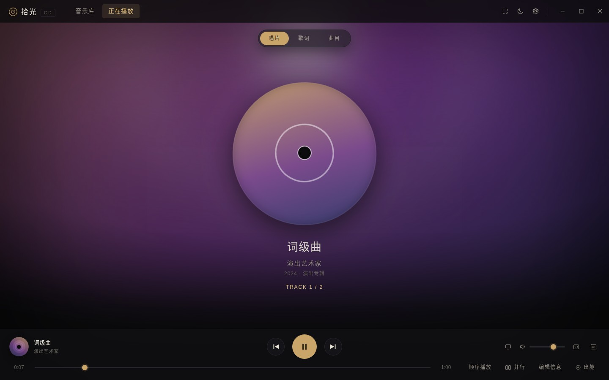
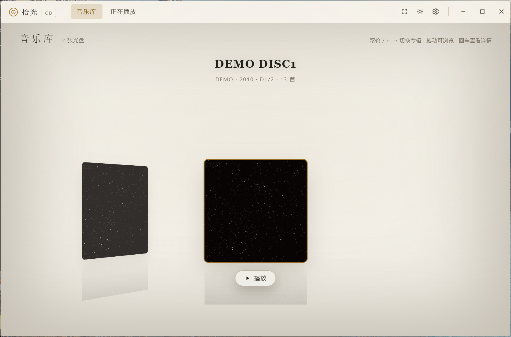
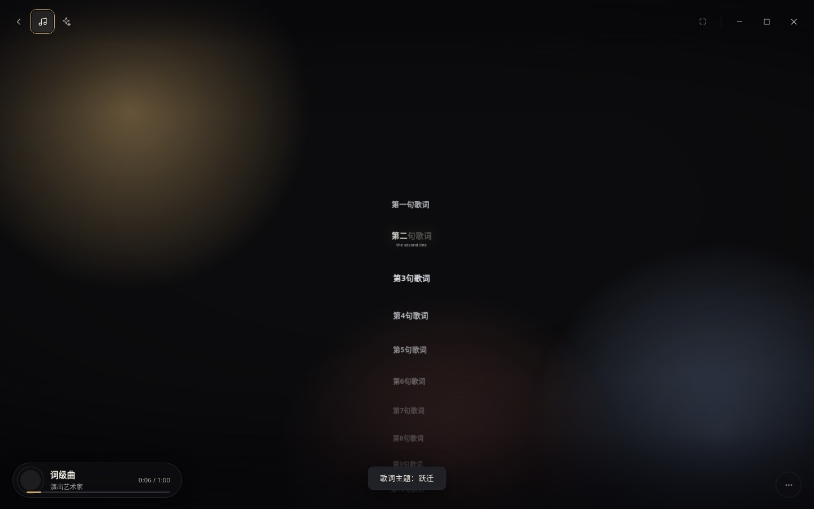
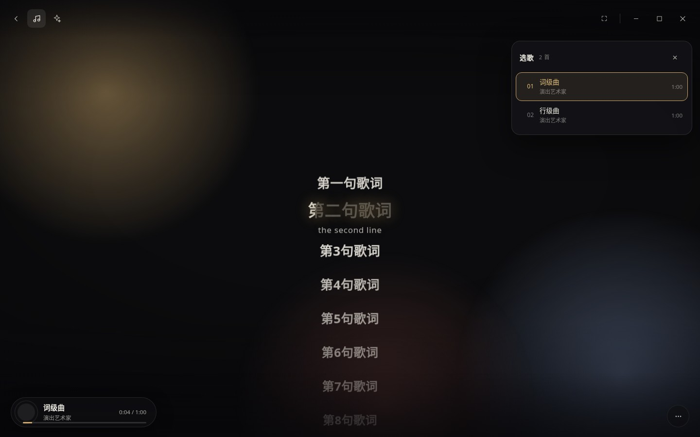
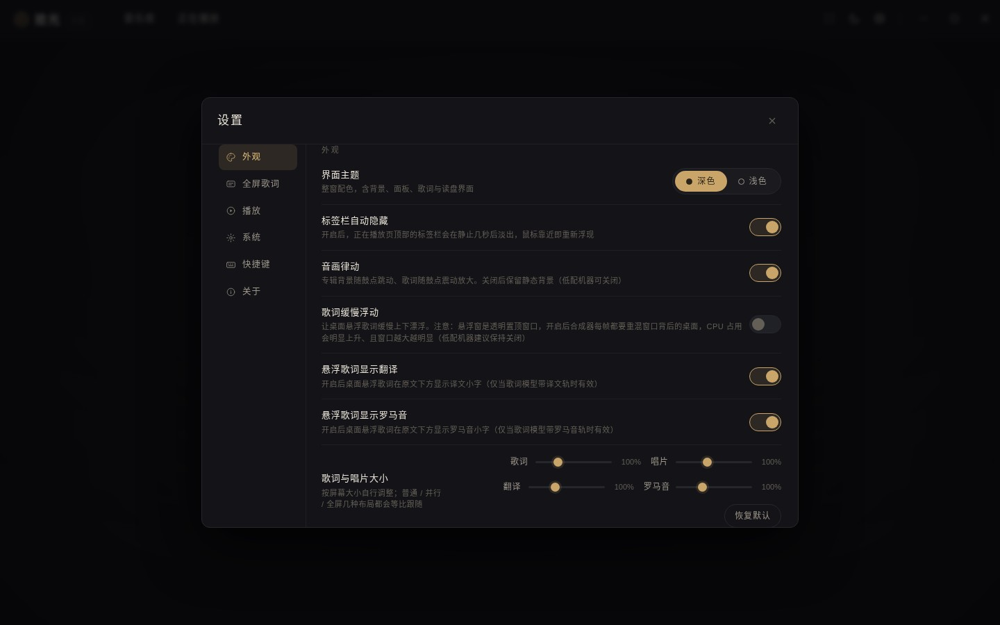
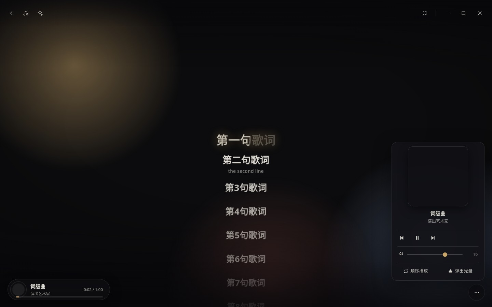

<div align="center">

# 拾光 · ShiGuangCD

**为 CD 而生的优雅桌面播放器** —— 兼容 Windows 7 – Windows 11

[](https://github.com)
[](#)
[](#)
[](LICENSE)
[](#快速开始)

</div>

---

## 这是什么

在流媒体时代，抽屉里那几张 CD 依然值得被认真对待。**拾光 CD** 是一个运行在 Windows 上的桌面 CD 播放器：放入光盘，读取曲目、抓取封面、匹配歌词，然后用一台「现代唱机」的仪式感把它播放出来。

你可以像管理数字游戏一样收集专辑，已被读取的专辑会被收入'音乐库'中。


> 没有光驱也没关系：`npm run demo` 演示模式可以直接体验完整界面。

## 截图
<table>
  <tr>
    <td align="center" width="50%"><b>正在播放(暗色）</b><br/>唱片机视觉 · 鼓点律动 · 背景色提取</td>
    <td align="center" width="50%"><b>音乐库</b><br/>管理你的CD、封面与元数据</td>
  </tr>
  <tr>
    <td></td>
    <td></td>
  </tr>
  <tr>
    <td align="center"><b>全屏歌词 · 跃迁 Warp</b><br/>歌词赛道沉入纵深，唱到的行跃迁到镜前</td>
    <td align="center"><b>菜单内封面 · 选歌面板</b><br/>大号封面、当前曲目高亮、一键切歌</td>
  </tr>
  <tr>
    <td></td>
    <td></td>
  </tr>
  <tr>
    <td align="center"><b>设置 · 左分类右内容</b><br/>外观 / 歌词 / 播放 / 系统 / 快捷键 / 关于</td>
    <td align="center"><b>全屏歌词菜单</b><br/>大号封面 + 歌名艺术家 + 播控</td>
  </tr>
  <tr>
    <td></td>
    <td></td>
  </tr>
</table>

## 功能特性

**光驱与播放**
- **双引擎读取**：优先 RAW 数字提取（扇区直读、波形平滑度判据、大小端字节序自动判别），异常时无缝回退 MCI——老机器、烂盘、混合盘都有逃生门
- **位置精度**：暂停点 / 续播点 / 定位落点一律回读设备真实值，不信任超前墙钟，歌词与进度永不打架
- **播放中看门狗**：连续全零 / 垃圾数据自动止损切引擎，不会卡在刺耳噪音上

**元数据与歌词**
- **离线优先的元数据**：MusicBrainz 在线匹配 + 本地缓存，封面穿透存储；全源不可达时骨架兜底，绝不放空
- **六源歌词降级链**：AMLL TTML 词级库优先，逐级回退，零真实请求的完整测试覆盖
- **逐字歌词引擎**：词级填充、译文、罗马音、对唱（x-bg）、间奏行一应俱全，与主界面 / 悬浮窗 / 全屏演出层三端同源

**界面与演出**
- **正在播放**：封面派生的动态背景、唱片机视觉、随鼓点律动；音乐库支持网格 / CoverFlow 两种浏览
- **全屏歌词演出层**（重头戏）：8 个主题，其中两个是 CSS 3D 运镜主题——**跃迁 Warp**（行阵沉入 Z 深处）与 **星环 Halo**（圆幕绕镜旋转），换行时镜头在歌词行之间**穿梭**；参数滑条实时可调，3D 主题同样支持逐字弹出
- **桌面悬浮歌词**：置顶透明窗、颜色 / 字号可调、亮度自适应底板
- **零第三方动画依赖**：演出层的补间由自写的 `tween.js` 承担（213 行 / 8.5KB，gzip 3.6KB），缓动曲线与 GSAP 逐点一致，随包组件里已无许可不兼容项
- **多语言（五门）**：简体中文 / 繁體中文 / English / 日本語 / Русский，设置里一键切换、即时生效；主界面、全屏演出层、桌面悬浮歌词、系统提示全部跟随，**切换时音乐不断**
- **系统集成**：Windows SMTC 媒体控件（封面 / 歌曲信息 / 媒体键）、全局快捷键、设置项全部落盘

## 技术细节

| 方面 | 做法 |
| --- | --- |
| 运行时 | Electron 22（Chromium 108 兼容老系统），单窗口 + 无边框自绘标题栏 |
| 光驱层 | `koffi` FFI 调原生 DLL；RAW 提取跑在 worker 线程，背压 + 看门狗 |
| 播放引擎 | RAW 数字提取 ↔ MCI 双引擎，能力测试自动预选，播放中可热切换 |
| 元数据 / 歌词 | MusicBrainz + 五源歌词解析（TTML / yrc / QRC / KRC / LRC），离线缓存 + 降级链 |
| 渲染纪律 | 帧内只写 CSS 变量 / `transform` / `opacity`，不重建 DOM 文本节点；补间只做一次性编排，不进逐帧热路径 |
| 3D 运镜 | CSS 3D（`perspective` + rig 变换），非 WebGL——CJK 文字保持系统字体清晰渲染、零下载、无降级链；圆环几何用多项式近似（Chromium 108 无 CSS `sin()/cos()`） |
| 多语言 | 自建 441 键 × 5 语言词典（`renderer/js/i18n.js`），静态标注 + `T()` 取词，回退链「当前语言 → 简体中文 → 键名」；切换只重排文案，不碰播放链路 |
| 动画 | 自写 `renderer/js/tween.js`（213 行 / 8.5KB，gzip 3.6KB；零依赖）：缓动与 GSAP 的 `power2/power3/sine` 同式同值，逐点互差 <0.3%；每帧 `style.setProperty`，不碰 `transition` |
| 测试 | 28 个 jsdom 套件（光驱 / 引擎 / 元数据 / 歌词 / 悬浮窗 / 演出层架构纪律锁）+ 真浏览器（Chromium）验证 |

## 快速开始

**环境要求**：编译机Windows 10 及以上 · Node.js ≥ 18

```bash
# 克隆
git clone https://github.com/shaojin666/ShiGuangCD-src
cd shiguang-cd-player

# 安装依赖（国内网络建议加 registry 镜像）
npm install --registry=（镜像地址省略）

# 运行（有光驱会自动探测；无光进入「未检测到光驱」页）
npm start

# 无光驱体验完整界面
npm run demo

# 跑测试（纯逻辑，不需要光驱、不需要 Windows）
npm test

# 打包 Windows 安装版（NSIS + zip，x64）
npm run dist
```

## 项目结构

```
shiguang-cd-player/
├── main/            # 主进程：光驱 / 双引擎 / 元数据 / 歌词 / 悬浮窗 / 字体仓库
├── preload.js       # 白名单 IPC 桥
├── renderer/        # 渲染进程：音乐库 / 正在播放 / 编辑 / 设置 / 全屏歌词演出层
│   ├── js/i18n.js   #   多语言词典与取词（441 键 × 5 语言）
│   ├── js/tween.js  #   补间引擎（v10.12 取代 GSAP，零依赖）
│   ├── js/fl-*.js   #   全屏歌词演出层（主题 / 运镜 / 选歌 / 胶囊 / 字体）
│   └── css/         #   样式（含设置双栏与 3D 主题）
├── tests/           # 28 个 jsdom 套件（npm test）
├── tools/           # 图标生成等小工具
├── build/                    # 打包资源（安装向导协议页 installer-license.txt）
├── LICENSE                   # GNU GPLv3 全文
├── THIRD-PARTY-LICENSES.md   # 随包第三方组件与许可
└── docs/
    ├── development.md     # 完整开发历程（架构 / 版本线 / 实测坑）
    ├── lyrics-design.md   # 逐字歌词设计笔记
    └── screenshots/       # README 截图
```

## 开发历程

本项目开发版本号从 v1.0 迭代至 v10.12（对外发布 1.0.0；v10.12 为多语言轮），每一轮的架构决策、实测抓坑与回归测试都记录在 **[docs/development.md](docs/development.md)**——包括 RAW 引擎的波形判据、位置权威链、逐字歌词引擎、全屏演出层的渲染纪律等。

## 注意事项

- 请仅对**你拥有合法权利的 CD** 使用本软件；歌词与元数据来自公共数据库，版权归原始权利人所有
- 开发与测试环境为 Windows 10/11；Windows 7 兼容性按设计约束维护（Electron 22 为最后支持 Win7 的大版本）

## 许可证

**GNU General Public License v3.0 或更高版本**（`GPL-3.0-or-later`）

协议全文见 [LICENSE](LICENSE)；随包分发的第三方组件及其许可（含兼容性说明）见 [THIRD-PARTY-LICENSES.md](THIRD-PARTY-LICENSES.md)。

### 你可以

| 自由 | 含义 |
|---|---|
| **运行** | 用于任何目的，包括商业环境下的自用 |
| **学习与修改** | 阅读源码、按需改动，自己保留改动也可以 |
| **再分发** | 复制、分发原件或修改版，**可以收费** |

### 你必须

- **附带源码**：分发二进制（安装包、zip）时，须以 GPLv3 提供**完整对应源码**，或给出有效期不少于三年的书面获取途径
- **保留声明**：不得删除版权声明与协议声明；修改版须显著标注「已修改」及修改日期
- **同协议**：衍生作品整体仍以 GPLv3 分发，不得转为闭源或附加更严格条款
- **不加限制**：不得对下游施加 GPLv3 之外的附加条件（例如禁止商用、捆绑 DRM 限制）

### 没有担保

本软件按「原样」提供，不附带任何明示或默示担保（包括适销性与特定用途适用性）。因使用本软件产生的损失，作者不承担责任。

> 一句话：**自己用、改、送人都随意；一旦对外分发，源码必须跟着开源，且不能改成闭源。**

### 贡献

提交 PR 即表示你同意该贡献以 `GPL-3.0-or-later` 授权，并确认你有权这样做。

## AI使用说明

本项目全过程使用多个AI进行开发，作者本人仅进行创意提供、实机测试。

### 参与开发的模型（排行按贡献程度）
1.Step5-Preview（RAW-read、全屏歌词、音乐库界面完善、专辑信息元数据获取、逐字歌词获取与支持等）
2.DeepSeek-V4.1-Flash（MCI播控完善、多语言支持、元数据获取等）
3.SpaceBunny（前端重构、桌面歌词、音乐律动、音乐库等）
4.Doubao（软件整体框架提供者，参与前期开发）

## 致谢

- [MusicBrainz](https://musicbrainz.org/) 与各公共歌词数据库提供的开放数据
- [amll-ttml-db](https://github.com/Steve-xmh/amll-ttml-db) 词级歌词库
- [Electron](https://www.electronjs.org/) / [koffi](https://koffi.dev/) / [Three.js](https://threejs.org/)
  
